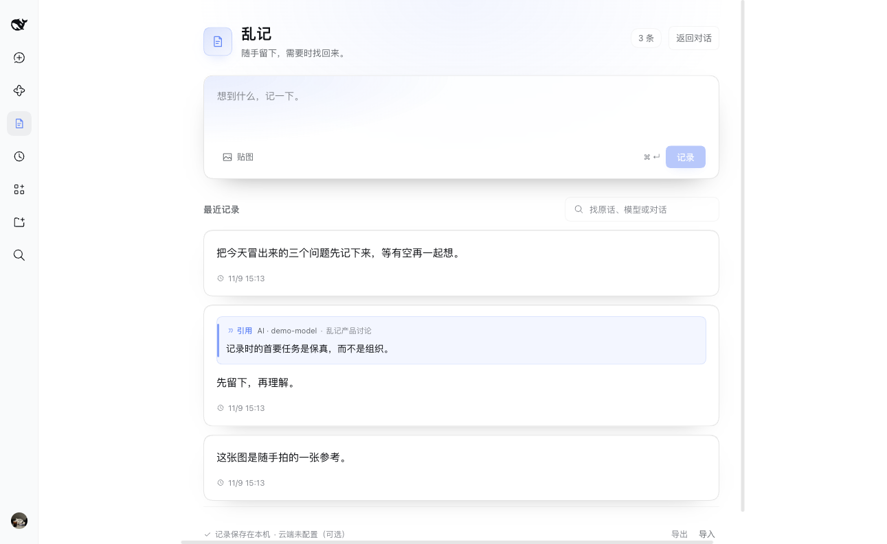
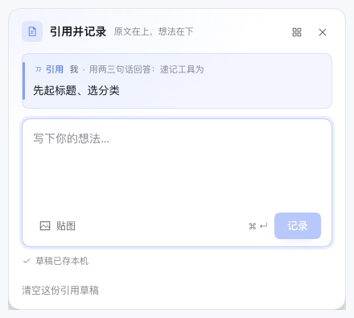
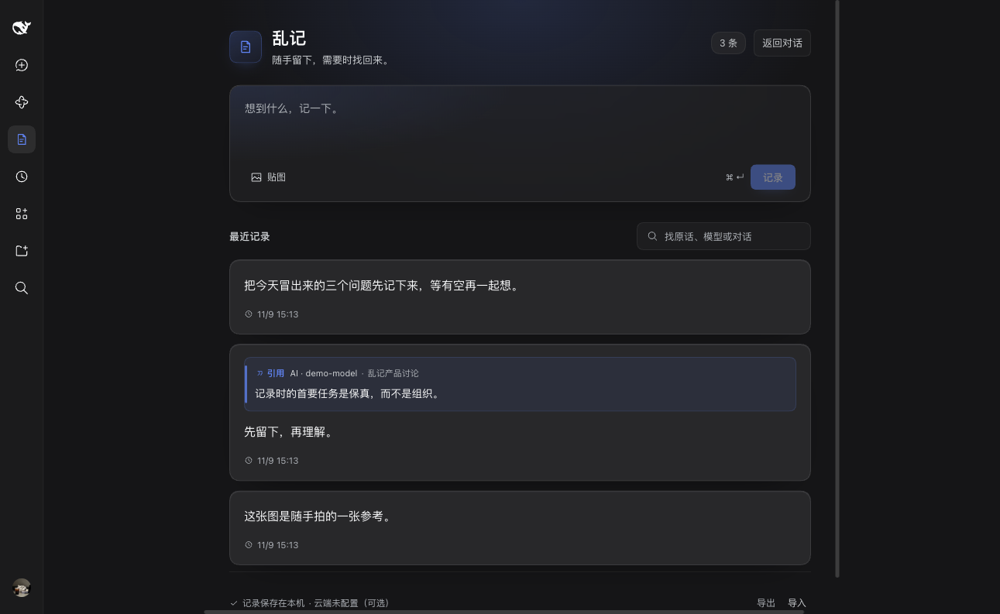

# 乱记 · dsh-luanji

[](./LICENSE)
[](#安装)
[](#数据与隐私)
[](./test)

> **一句话：** 在 DSH 里和 AI 对话时，随手把一句话、一个念头、一张图留下来。先记住，不必先起标题、选分类。
>
> **In one line:** a local-first quick-capture plugin for DeepSeek Harness. Select a sentence, save it with your own thought, find it later — no titles, no tags, no friction.



## 它是什么

乱记长在你和 AI 碰撞想法的地方：左侧面板一行「乱记」，点一下弹记录便签；划选对话里的原话，直接存成一条带出处的引用。所有内容默认只在本机一个 JSON 文件里，随时导出走人；想接自己的云端数据服务时，再手动配置。

- **本地优先**：默认不联网、不需要账号，数据在 `~/.dsh/luanji/notes.json`。
- **划选即记**：选中一句话，DSH 原生浮动条上直接「记录 / 引用并记录 / 引用文本」。
- **原文与想法分开存**：引用保留来源（模型、对话、文本锚点），自己的想法单独编辑；展示时引用在上、想法在下。
- **会回来**：原句在对话里以淡底 + 下划线标记，刷新/回到对话仍能恢复；记录可「回到对话」。
- **可选云端**：配置自己的「乱记兼容」数据服务后，可手动从云端拉取 / 推送到云端（见 [docs/cloud-sync.md](docs/cloud-sync.md)）。

## 界面一览

划选对话里的原话，浮动条上直接「记录 / 引用并记录 / 引用文本」：


引用便签：原文在上、想法在下，来源（模型 · 会话）跟着走：



点侧栏「乱记」行，就近弹出速记便签，先记住、不必先起标题：


管理面板：搜索、编辑、导入导出，明暗两套主题：



## 入口与操作

| 入口 | 操作 |
|---|---|
| 左侧面板「乱记」 | 点整行 → 就近弹出记录便签；点行尾小按钮 → 进入乱记面板 |
| 划选对话原文 | 原生浮动条：`记录` 直接存；`引用并记录` 先写想法；`引用文本` 放回输入框（DSH 原行为） |
| 乱记面板 | 直接记录、图片、搜索、编辑/删除、导入导出、云端同步 |

| 快捷键 | 作用 |
|---|---|
| `⌘ / Ctrl + Shift + L` | 打开记录便签 |
| `⌘ / Ctrl + Enter` | 保存当前输入 |
| `Esc` | 收起便签，保留草稿 |
| `⌘ / Ctrl + K` | 在面板聚焦搜索 |

便签、面板、引用分别保留草稿；输入停止约 400 ms 后写入本机。一条记录最多 6 张图片（PNG/JPEG/WebP/GIF，单文件 ≤ 20 MB，保存前缩到最长边 1600，最多 20,000 字）。

## 安装

> 环境：DeepSeek Harness（DSH）桌面端 / web profile。插件是 Host + Client 两半的 bundle，Host 需要 `webServer` 等平台服务。

**方式一：命令行（推荐）**

```bash
git clone https://github.com/Thomas-zz/dsh-luanji.git

# macOS 桌面端的 dsh CLI 在 app 内：
DSH="/Applications/DeepSeek Harness.app/Contents/Resources/runtime/cli/bin/dsh"

# 安装到你的 profile（link 方式，改代码即生效）
"$DSH" plugin --profile desktop add "$PWD/dsh-luanji"
```

然后重启 DSH 桌面端（Host 改动需要重启；`client.js` 改动保存后热更新）。

**方式二：插件管理器**

设置 → 插件 → 从本地目录安装 `dsh-luanji`，并确认 profile 的 `dsh.profile.bundles` 包含该 bundle。

**数据文件**

```
~/.dsh/luanji/notes.json        # 记录 + 引用 + 草稿
~/.dsh/luanji/notes.json.bak    # 上一次写入前的备份
~/.dsh/luanji/cloud-sync.json   # 可选云端同步的时间/结果（不存凭据）
```

卸载：设置 → 插件里禁用/移除，或 `"$DSH" plugin --profile <profile> remove dsh-luanji`。

## 本地 + 云端（可选）

默认完全本地。想接自己的数据服务时，在 profile 的 `cordis.patch.yml` 里：

```yaml
- id: dsh-luanji
  name: '@dsh-external/dsh-luanji'
  config:
    cloud:
      url: https://zjuan.club
      token: '<你的长期 token>'      # 或 cookie / headers
      timeoutMs: 15000
```

配置后面板里会出现「云端 · host」和「从云端拉取 / 推到云端」两个按钮；命令行也可以用 `node scripts/sync-now.mjs`。端点契约、认证方式、合并规则（同 id 按 `updated_at`、引用不上云、删除不同步、图片标记映射）见 **[docs/cloud-sync.md](docs/cloud-sync.md)**。

## 数据与兼容

- v2 格式把 `records`（自己的内容）和 `quotes`（原始引用 + 来源）分开，用 `quoteId` 关联；另有 `drafts`。
- 写入先写临时文件、`fsync`，再原子替换；读取损坏文件时保留原文件并报错，不会用空记录覆盖。
- 导入支持旧版文字记录与 v2 导出；导出 JSON 含图片。
- 搜索覆盖正文、引用原文、模型名和对话名，是文字/模糊匹配，不是语义搜索。

## 开发与验证

```bash
npm test                 # 32 tests：store / routes / cloud
node --check client.js
node test/dev-server.mjs 8129   # 隔离开发页（不碰真实笔记目录）
```

- [产品与交互决策](docs/product-capture.md)
- [本地+云端同步设计](docs/cloud-sync.md)
- [2026-11-05 记录与找回验证](docs/verification-20261105.md)
- [2026-11-06 界面改版验证](docs/verification-20261106.md)
- [2026-11-06 云端同步验证](docs/verification-cloud-sync.md)

主要文件：`client.js` 交互与主题；`host/store.js` 记录数据；`host/cloud.js` 可选云端同步；`host/routes.js` 本机 API；`host/search.js` 搜索；`host/tool.js` agent 工具；`test/` 测试与隔离开发页。

## 许可

[MIT](LICENSE)
